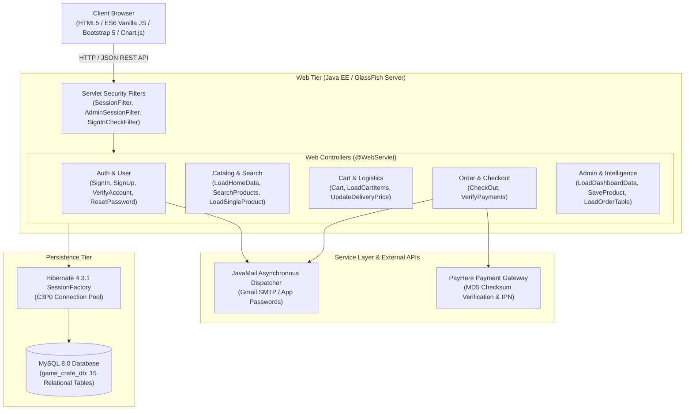

# GameCrate.lk — Enterprise Gaming E-Commerce Platform

[](https://www.oracle.com/java/)
[](https://hibernate.org/)
[](https://www.mysql.com/)
[](https://glassfish.org/)
[](https://www.payhere.lk/)
[](LICENSE)

An enterprise-grade, multi-tier e-commerce web application purpose-built for gaming hardware, next-generation consoles (PlayStation, Xbox, Nintendo Switch), physical gaming media, and accessories. Built using Java Enterprise Edition (Servlets & Filters), Hibernate ORM with C3P0 connection pooling, MySQL 8.0, asynchronous JavaMail notification pipelines, and PayHere payment gateway integration.

---

## Architecture Overview



---

## Core Features & Engineering Highlights

### 1. Robust Java EE & Hibernate ORM Backend
- **MVC Architecture**: Strict decoupling between Presentation (HTML5/ES6/Bootstrap), Controller (`@WebServlet` request processors), and Data Access layers (Hibernate mapped entities).
- **Hibernate Criteria API**: Complex, dynamic multi-facet filtering for gaming consoles and titles by Category, Platform, Genre, and Price ranges with zero concatenated SQL strings.
- **C3P0 Connection Pooling**: High-concurrency database connection management with automated recovery and idle connection pruning.

### 2. Multi-Tier Security & Filter Interceptors
- **Declarative Servlet Filters (`@WebFilter`)**: Role-based access control protecting customer sessions (`SessionFilter`, `SignInCheckFilter`) and administrative dashboards (`AdminSessionFilter`, `AdminSignInCheckFilter`).
- **Cryptographic Payment Integrity**: Server-side PayHere MD5 checksum generation (`PayHere.generateMD5`) prevents client-side price manipulation.
- **Instant Payment Notification (IPN)**: Server-to-server webhook verification (`VerifyPayments`) for real-time payment validation and order confirmation.

### 3. Asynchronous Mail Notification Pipeline
- **Thread-Isolated Dispatch**: Transactional emails (one-time registration verification codes, password resets, and formatted HTML invoices) are dispatched on dedicated background threads, eliminating HTTP latency.
- **Rich HTML Invoicing**: Auto-generates branded invoices complete with itemized breakdown, customer delivery coordinates, and order tracking numbers.

### 4. Logistics & Smart Checkout
- **Location-Aware Shipping**: Dynamic delivery fee recalculation based on regional municipal boundaries (Kurunegala urban vs. Island-wide distribution).
- **Multi-Address Management**: Saved delivery profiles with validation for postal codes and address lines.

### 5. Administrative Business Intelligence Dashboard
- **Real-Time KPI Analytics**: Total revenue metrics, real-time inventory counts, order status velocity, and customer acquisition tracking.
- **Visual Analytics**: Dynamic graphical trend reporting powered by Chart.js.
- **Stock & Product Management**: Granular control over categories, platforms, genres, pricing, stock levels, and product image uploads.

---

## Relational Database Schema (`game_crate_db`)

The database consists of 15 normalized relational tables managed via Hibernate ORM:

| Table | Description |
| :--- | :--- |
| `admin` | Administrative credentials and access control |
| `user` | Customer profiles, credentials, mobile, and verification status |
| `user_status` | User account lifecycle state (Active, Blocked) |
| `address` | Shipping addresses linked to customer accounts |
| `city` | Municipalities and districts for shipping calculations |
| `delivery_type` | Regional shipping tiers and delivery fee structures |
| `category` | Hardware, Consoles, Video Games, Accessories |
| `platform` | PS5, PS4, Xbox Series X/S, Nintendo Switch, PC |
| `genre` | Action, RPG, Shooter, Adventure, Racing, Sports, etc. |
| `product` | Catalog items with SKU, title, description, price, quantity |
| `product_status` | Stock status (Available, Out of Stock, Delisted) |
| `cart` | Persistent and session-linked shopping cart entries |
| `orders` | Master orders table capturing order date, delivery type, and total |
| `order_items` | Line items capturing product snapshot, unit price, and quantity |
| `order_status` | Order lifecycle (Pending, Processing, Dispatched, Delivered, Cancelled) |

The complete SQL schema and initial seed data are provided in [`database/schema.sql`](database/schema.sql).

---

## Tech Stack

- **Backend Platform:** Java EE 7 / 8 (`javax.servlet`, `javax.mail`)
- **ORM / Persistence:** Hibernate 4.3.1 Final, C3P0 0.9.2.1, MySQL Connector/J 8.4
- **Database Engine:** MySQL 8.0 / MariaDB
- **Application Server:** GlassFish Server 4.x / 5.x / Payara Server
- **IDE & Build System:** Apache NetBeans 20, Apache Ant
- **Serialization:** Google Gson 2.10.1
- **Payment Processing:** PayHere Payment Gateway (MD5 HMAC Sandbox & Live)
- **Frontend:** HTML5, CSS3, JavaScript (ES6 `fetch` / `async-await`), Bootstrap 5.1.3, FontAwesome 6.2, Chart.js

---

## Getting Started

### Prerequisites
- **JDK:** Java Development Kit 8, 11, or 17
- **IDE:** Apache NetBeans IDE (v12, v17, or v20+)
- **Server:** GlassFish Server 4.x / 5.x or Payara Server configured in NetBeans
- **Database:** MySQL 8.0 Server (e.g., via XAMPP or standalone MySQL Server)

---

### Step 1: Clone Repository
```bash
git clone https://github.com/MalindaDasanayaka/gamecrate-ecommerce-java.git
cd gamecrate-ecommerce-java
```

---

### Step 2: Database Setup
1. Start your local MySQL service (e.g., port 3306).
2. Create the database and import the schema:
```bash
mysql -u root -p -e "CREATE DATABASE IF NOT EXISTS game_crate_db;"
mysql -u root -p game_crate_db < database/schema.sql
```

---

### Step 3: Hibernate Configuration
Verify or adjust your MySQL connection credentials in [`src/java/hibernate.cfg.xml`](src/java/hibernate.cfg.xml):
```xml
<property name="hibernate.connection.url">jdbc:mysql://localhost:3306/game_crate_db?useSSL=false&amp;allowPublicKeyRetrieval=true</property>
<property name="hibernate.connection.username">root</property>
<property name="hibernate.connection.password">YOUR_DATABASE_PASSWORD</property>
```

---

### Step 4: Environment Variables (Optional)
Configure the following environment variables in your operating system or GlassFish domain `domain.xml` JVM options:

| Variable | Description | Default Fallback |
| :--- | :--- | :--- |
| `APP_EMAIL` | Gmail SMTP sender address for transactional mail | `support@gamecrate.lk` |
| `APP_PASSWORD` | Google 16-character App Password | Sandbox Mock |
| `PAYHERE_MERCHANT_ID` | PayHere Merchant ID | `1226818` (Sandbox) |
| `PAYHERE_MERCHANT_SECRET` | PayHere Merchant Secret | Sandbox Secret |
| `PAYHERE_NOTIFY_URL` | PayHere Server-to-Server IPN callback URL | `http://localhost:8080/GameCrate/VerifyPayments` |

A reference configuration template is provided in [`.env.example`](.env.example).

---

### Step 5: Build and Run in Apache NetBeans
1. Open Apache NetBeans IDE.
2. Go to **File** -> **Open Project** and select `gamecrate-ecommerce-java`.
3. Right-click the project -> **Properties** -> **Run**:
   - Ensure **Server** is set to **GlassFish Server**.
   - Context Path: `/GameCrate`
4. Right-click the project and select **Clean and Build**.
5. Right-click the project and select **Run**.
6. The web application will launch at:
   - **Storefront:** `http://localhost:8080/GameCrate/`
   - **Admin Portal:** `http://localhost:8080/GameCrate/admin-sign-in.html`

---

## Demo Credentials

For demonstration and testing purposes, the seed database includes pre-configured accounts:

| Portal | Role | Username / Email | Password |
| :--- | :--- | :--- | :--- |
| **Customer Portal** | Customer | `customer@gamecrate.lk` | `Customer@2026` |
| **Admin Portal** | System Administrator | `admin@gamecrate.lk` | `Admin@GameCrate2026` |

---

## Project Structure

```
GameCrate/
├── database/
│   └── schema.sql                 # Complete MySQL DDL schema and seed records
├── lib/
│   ├── CopyLibs/                  # NetBeans build task dependencies
│   ├── Hibernate/                 # Hibernate 4.3.1 ORM, C3P0, MySQL Connector/J
│   ├── javaee-endorsed-api-7.0/   # Java EE endorsed APIs
│   ├── gson-2.10.1.jar            # Google JSON parser library
│   └── nblibraries.properties     # NetBeans library path registry
├── nbproject/                     # NetBeans project configuration
│   ├── ant-deploy.xml
│   ├── build-impl.xml
│   ├── project.properties
│   └── project.xml
├── src/
│   └── java/
│       ├── controller/            # Java EE Web Servlets (@WebServlet)
│       │   ├── AdminSignIn.java
│       │   ├── CheckOut.java
│       │   ├── LoadDashboardData.java
│       │   ├── SaveProduct.java
│       │   ├── SearchProducts.java
│       │   ├── SignIn.java
│       │   ├── SignUp.java
│       │   ├── VerifyPayments.java
│       │   └── ... (29 Controllers)
│       ├── hibernate/             # Hibernate Entity Mappings & HibernateUtil
│       │   ├── Address.java
│       │   ├── Admin.java
│       │   ├── Cart.java
│       │   ├── HibernateUtil.java
│       │   ├── Orders.java
│       │   ├── Product.java
│       │   ├── User.java
│       │   └── ... (17 Mappings)
│       ├── model/                 # Security Filters & Utilities
│       │   ├── AdminSessionFilter.java
│       │   ├── Mail.java
│       │   ├── PayHere.java
│       │   ├── SessionFilter.java
│       │   └── Util.java
│       └── hibernate.cfg.xml      # Hibernate SessionFactory database config
├── web/
│   ├── assets/                    # CSS, JavaScript, and UI icons
│   ├── product-images/            # High-resolution gaming product catalog media
│   ├── admin-dashboard.html       # Analytics & administrative BI console
│   ├── admin-product-management.html
│   ├── cart.html                  # Shopping cart interface
│   ├── checkout.html              # Multi-step checkout & payment terminal
│   ├── index.html                 # E-commerce homepage
│   ├── my-account.html            # User profile & order history
│   └── search.html                # Dynamic product search & catalog filters
├── .env.example                   # Environment variable template
├── .gitignore                     # Git ignore rules for NetBeans & build artifacts
├── build.xml                      # Ant build script
├── LICENSE                        # MIT License
└── README.md                      # Comprehensive project documentation
```

---

## Security & Sanitization Compliance

- **Zero Hardcoded Secrets**: All production secrets, SMTP passwords, and payment tokens are decoupled via environment variables.
- **Sanitized Seed Data**: Real personal emails, contact numbers, and physical addresses have been replaced with anonymized sample fixtures.
- **Session Protection**: Administrative routes and checkout flows are guarded against unauthorized or unauthenticated access through servlet filter pipelines.

---

## License

This project is licensed under the MIT License — see the [LICENSE](LICENSE) file for details.

---

## Author

**Malinda Dasanayaka**  
- GitHub: [@MalindaDasanayaka](https://github.com/MalindaDasanayaka)
